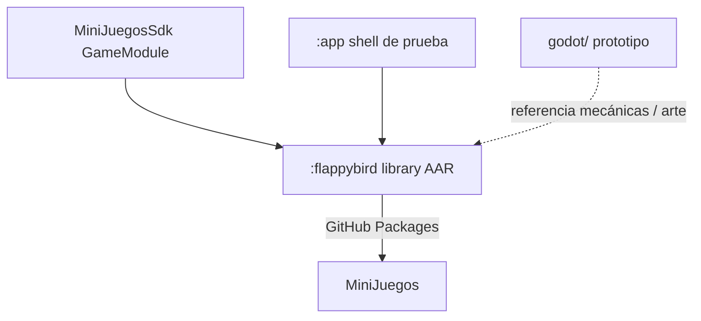

# Estructura — Flappy Bird

## Rol en el ecosistema



## Árbol del proyecto

```
FlappyBirdCopy/                  # path local (repo GitHub: FlappyBird)
├── .github/workflows/ci.yml
├── app/                         # APK de prueba
│   └── …/app/MainActivity.kt
├── flappybird/                  # Library → AAR
│   └── src/main/java/…/flappybird/
│       ├── FlappyBirdGameModule.kt
│       ├── domain/              # FlappyEngine + modelos
│       ├── data/                # HighScoreRepository
│       ├── presentation/        # Canvas + ViewModel + SFX
│       └── ui/theme/
├── godot/                       # Prototipo Godot 4 (no va en el AAR)
└── docs/
```

## Capas del library

| Capa | Contenido |
|------|-----------|
| `domain` | `FlappyEngine`, física/colisiones/score (testeable sin Android) |
| `data` | High score (`SharedPreferences`) |
| `presentation` | `FlappyScreen` (Canvas + overlays), `FlappyViewModel`, `FlappySounds` |
| Entry | `FlappyBirdGameModule` aplica tema y pasa `onExit` |

## Dualidad library + shell

| | `:flappybird` | `:app` |
|--|---------------|--------|
| Salida | AAR | APK |
| `applicationId` | no | `pelkidev.com.mx.flappybird` |
| Entry | `FlappyBirdGameModule` | `MainActivity` → `Entry` |
| Recursos | prefijo `flappybird_` | launcher, tema de app |
